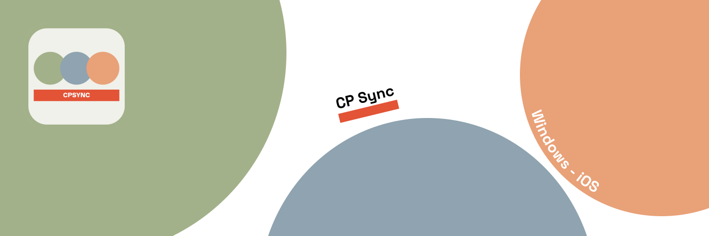

# CpSync



Cross-platform clipboard sync — copy on iOS, paste on Windows or Linux instantly.

## How it works

A lightweight WebSocket relay server connects an iOS app to a Windows or Linux tray client. Both sides share a **room secret** to pair with each other. When you copy something on iOS, it appears in your desktop clipboard within seconds.

```
[iOS App] ──── WebSocket ────► [Server] ────► [Windows / Linux Tray]
   copy                         relay                 paste
```

## Apps

| App | Stack | Description |
|-----|-------|-------------|
| [`apps/ios`](apps/ios) | Swift / SwiftUI | Monitors clipboard and sends changes over WebSocket |
| [`apps/server`](apps/server) | Python / aiohttp | Self-hosted WebSocket relay server |
| [`apps/windows`](apps/windows) | Python | System tray app that receives and writes to clipboard |
| [`apps/linux`](apps/linux) | Python / PySide6 | Same thing for Linux (Wayland & X11), shipped as an AppImage |

## Usage

> **Heads up on `wss://`:** all clients expect a **secure** WebSocket endpoint. The Windows and
> Linux apps hardcode `wss://` and cannot connect to a plain `ws://` server at all. The iOS app lets
> you type any scheme, but in practice you want TLS in front of the server for anything beyond
> same-machine testing.

### 1. Server

The server is a stateless aiohttp relay with two routes:

- `GET /` — health check, returns `200 OK`
- `GET /ws?room=<name>` — WebSocket endpoint; every peer connected with the same `room` value
  receives what the others send

**Run locally**

```bash
cd apps/server
pip install -r requirements.txt
python server.py
```

Reads the port from the `PORT` environment variable (defaults to `8765`). For local testing
with the real clients, tunnel it through TLS, e.g. `ngrok http 8765` or
`cloudflared tunnel --url http://localhost:8765`, and use the tunnel's `https` host as your
`wss://` endpoint.

**Deploy / host**

Anything that can run a long-lived Python process and terminate TLS in front of it works:

- **Railway / Render / Fly.io** — point a new web service at this repo, set the root to
  `apps/server`, install from `requirements.txt`, and set the start command to
  `python server.py`. These platforms give you a `wss://`-capable HTTPS hostname out of the box.
- **Plain VPS** — run `python server.py` under a process supervisor (systemd, pm2, supervisor),
  then reverse-proxy it through nginx or Caddy for TLS, forwarding `/` and `/ws` to
  `127.0.0.1:$PORT`.

Whichever you pick, note the public hostname — you'll enter it in both clients below.

### 2. iOS app

Requires a Mac with Xcode and an Apple ID (free personal-team signing is enough — no paid
Apple Developer account needed to run on your own device).

1. Open `apps/ios/CpSync.xcodeproj` in Xcode.
2. Plug in your iPhone/iPad, select it as the run destination, and set your Team under
   *Signing & Capabilities* if prompted.
3. Build & run (⌘R), then trust the developer certificate on-device if iOS asks
   (Settings → General → VPN & Device Management).
4. The Settings sheet opens automatically on first launch (tap the gear icon to reopen it
   later):
   - **WebSocket URL** — the *full* URL including scheme and path, e.g.
     `wss://my-server.example.com/ws` (not just the hostname).
   - **Room name / secret key** — must match the Windows/Linux app's room secret exactly.
5. Dismiss Settings to connect. The status card shows connected/disconnected; copying text
   anywhere on the device sends it automatically while connected, "Send Clipboard" forces an
   immediate send, and the history list below shows recent syncs in both directions.

Background behavior: to keep syncing while the app isn't in the foreground, it plays a silent,
near-zero-volume audio stream to stay alive (see `BackgroundAudioKeepAlive.swift`) — this is why
you'll see the audio-playing indicator in the status bar / Control Center while connected. It
requires the `audio` background mode, already declared in `Info.plist`.

### 3. Windows app

Two ways to run it:

- **Prebuilt release (no Python needed)** — grab `CpSyncTray-<version>-windows.zip` from the
  [Releases](../../releases) page, unzip, and run `CpSyncTray.exe`.
- **From source**:
  ```bash
  cd apps/windows
  pip install -r requirements.txt
  python clipboard_tray.py
  ```

On first launch (or whenever `config.json` is missing/incomplete) a dialog asks for:

- **Server host** — bare hostname only, e.g. `my-server.example.com` — no `wss://` prefix and
  no path. The app builds `wss://<host>/ws?room=<secret>` itself.
- **Room secret** — must match the iOS app's room name exactly.

Settings are saved next to the script (or the `.exe`) as `config.json`, which is git-ignored.

Once running, it lives entirely in the system tray:

- Icon color reflects connection state: grey (not configured/connecting), green (connected),
  red (disconnected, retrying every 5s).
- Right-click the icon for the menu: live connection status, **Recent** (click any of the last
  10 synced items to copy it again), **Mute notifications**, **Configure…** (reopen the setup
  dialog), and **Quit**.
- Unless muted, a toast notification (with a "Copy again" action) and a system beep fire every
  time new clipboard content arrives from iOS.

### 4. Linux app

Same features as the Windows app, built with Qt (PySide6) so it runs natively on Wayland
(tested on CachyOS + GNOME) as well as X11.

- **Prebuilt release** — grab `CpSync-<version>-x86_64.AppImage` from the
  [Releases](../../releases) page, `chmod +x` it, and run it. `wl-copy` is bundled, nothing to
  install. Needs glibc ≥ 2.35 (Ubuntu 22.04 or newer, any rolling distro).
- **From source**:
  ```bash
  cd apps/linux
  pip install -r requirements.txt
  python cpsync_tray.py        # needs wl-clipboard (Wayland) or xclip (X11) on PATH
  ```

Config is the same two fields (server host, room secret) and is saved to
`~/.config/cpsync/config.json`.

Tray vs. window: the app uses the system tray when the desktop offers one (KDE, Hyprland/waybar,
GNOME **with** the [AppIndicator extension](https://extensions.gnome.org/extension/615/appindicator-support/)).
Without a tray it falls back to a small window with the same controls: connection status,
**Recent** list (click to copy), **Mute notifications**, **Configure…**, **Quit**.
Notifications go through the desktop's notification daemon and carry a "Copy again" button.

Build the AppImage locally:

```bash
cd apps/linux
pip install -r requirements.txt pyinstaller
./build-appimage.sh          # needs wl-copy and appimagetool on PATH (or $WL_COPY / $APPIMAGETOOL)
```

## Releases

Each app ships independently via its own tag prefix. Pushing a tag triggers a GitHub Actions
workflow that builds the artifact and publishes a GitHub Release:

| Tag pattern | Workflow | Artifact |
|-------------|----------|----------|
| `windows-v1.2.0` | [release-windows.yml](.github/workflows/release-windows.yml) | Standalone `CpSyncTray.exe`, zipped |
| `linux-v1.2.0` | [release-linux.yml](.github/workflows/release-linux.yml) | `CpSync-<tag>-x86_64.AppImage` |
| `server-v1.2.0` | [release-server.yml](.github/workflows/release-server.yml) | Zipped source (`server.py`, `requirements.txt`) |
| `ios-v1.2.0` | [release-ios.yml](.github/workflows/release-ios.yml) | Zipped source (build locally in Xcode — not signed/built in CI) |

To cut a release:

```bash
git tag windows-v1.2.0
git push origin windows-v1.2.0
```

## Security

- The room secret is never stored in code — it is entered at runtime and kept on-device only.
- The server is a stateless relay: it never stores clipboard content, only forwards messages between peers in the same room.
- Use a strong, random room secret to prevent unauthorized access.

## License

MIT
